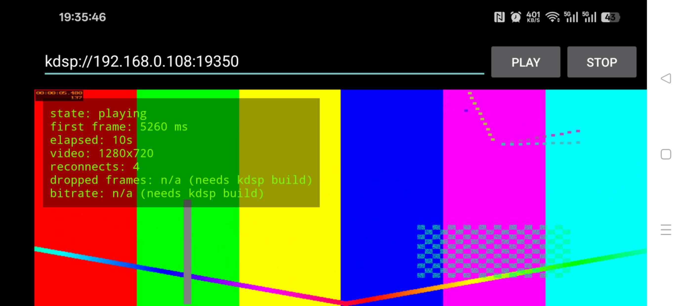

# Adding a proprietary protocol to ijkplayer/FFmpeg — a working demo

Many hardware devices — IP cameras, video intercoms, drone video links,
recorders — do **not** stream plain RTSP. Their streams carry a proprietary
frame header, a private timestamp, sometimes a private transport. Stock
players (ExoPlayer, a vanilla ijkplayer build) cannot open them at all.

This repository demonstrates, end to end, how such a protocol gets integrated
into an FFmpeg-based Android player:

1. a fictional proprietary protocol (**KDSP**, spec in
   [protocol.md](protocol.md)) — invented for this demo, resembling what real
   device vendors ship;
2. a small server that streams it (`server/`);
3. the player-side integration in FFmpeg's protocol layer for ijkplayer, so
   the Android app can simply open `kdsp://host:port` (`player/`);
4. a minimal Android demo app with live playback stats: first-frame time,
   elapsed playback time, video size, auto-reconnect counting. (The
   protocol layer also tracks dropped frames and wire bitrate; those
   counters are currently logged natively, not yet surfaced in the app UI.)

> Status: **complete and verified end-to-end (2026-11-10).** The FFmpeg
> protocol implementation lives in `player/ffmpeg-patch/`, the arm64 build
> is reproducible from `player/ijkplayer-build.md`, and the demo app was
> verified playing on a real Android phone over a LAN (first frame
> 5,260 ms — most of it raw-stream probing; 1280×720 at 25 fps). A stock
> player cannot play this stream; the patched player can. The full
> diagnosis trail, including a failed first device test and its root
> cause, is recorded in `docs/build-companion.md`.



## Quick start

```bash
# 1. Generate the sample stream (synthetic test pattern, no copyrighted media)
cd server && ./generate_sample.sh

# 2. Start the KDSP streaming server
python3 kdsp_server.py --file sample.h264 --port 19350
#    weak-network demo:  python3 kdsp_server.py --drop 0.05 --jitter 40

# 3. Build & install the Android demo app (see player/ijkplayer-build.md),
#    then enter:  kdsp://<your-PC-LAN-IP>:19350
```

## What this proves

- **FFmpeg internals, not player APIs** — the integration point is a custom
  `URLProtocol` in libavformat (header parsing, resync on bad magic, sequence
  tracking), not a Java-level workaround.
- **Custom ijkplayer builds** — pinned, reproducible build of the
  ijkplayer/FFmpeg stack for arm64-v8a (see `player/ijkplayer-build.md` and
  `docker/`).
- **Live-stream behaviour** — reconnect after the server dies, loss/jitter
  statistics, latency estimation from the protocol timestamp.
- **Diagnosis-first working style** — the same steps, in the same order, that
  a real vendor-protocol integration follows: spec → server/simulator →
  protocol layer → player → stats.

## Repository layout

```
protocol.md            KDSP protocol specification (fictional)
server/                streaming server + sample generator (Python, tested)
player/ffmpeg-patch/   where the FFmpeg protocol code goes, and why there
player/app/            Android demo app
player/ijkplayer-build.md   reproducible custom build notes
docs/                  build & diagnosis notes, real-device screenshot
docker/                frozen build environment for the native stack
```

## Licensing

Original code in this repository is MIT-licensed (see `LICENSE`).
It builds on **FFmpeg** and **ijkplayer**, which are **LGPL-2.1 or later**
components — see `NOTICE.md`. This demo is a proof of skill, not a
redistribution of either project.

## Need this for a real device protocol?

I take on a small number of fixed-price integrations of proprietary
streaming protocols into ijkplayer/FFmpeg-based Android players — starting
with a fixed-price feasibility diagnosis based on your protocol document and
a sample stream, before any development quote. (Contact via GitHub profile.)
