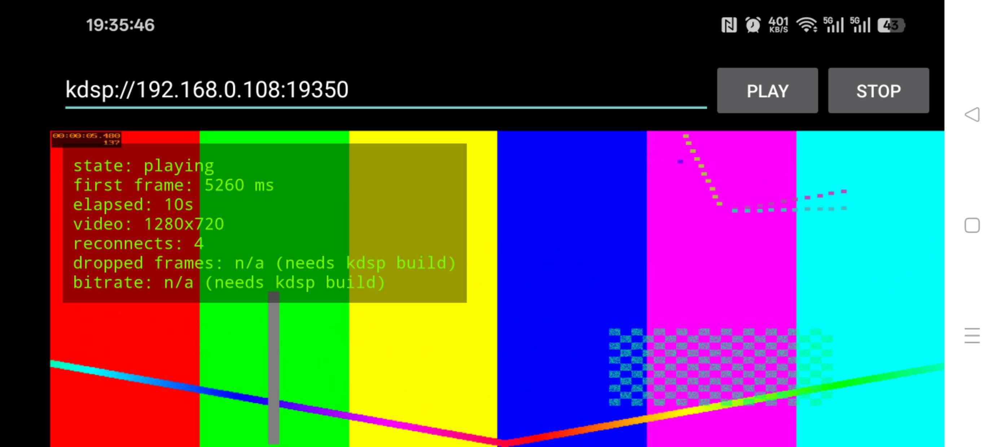

# 给 ijkplayer/FFmpeg 接入私有协议 — 可运行的证明 Demo

很多硬件设备（摄像头、视频对讲、无人机图传、录像设备）的码流并不是标准
RTSP：带私有帧头、私有时间戳、甚至私有传输方式。现成播放器（ExoPlayer、
原版 ijkplayer 构建）根本打不开。

这个仓库完整演示一遍这类协议如何接进基于 FFmpeg 的安卓播放器：

1. 一个虚构的私有协议 **KDSP**（规范见 [protocol.md](protocol.md)，为本
   Demo 发明，形态仿真实设备厂商协议）；
2. 一个推这个协议的测试流服务端（`server/`）；
3. 在 FFmpeg 协议层为 ijkplayer 做的播放器侧接入，使安卓 App 可以直接
   打开 `kdsp://主机:端口`（`player/`）；
4. 一个极简安卓 Demo App，带实时统计：首帧耗时、已播放时长、视频尺寸、
   自动重连计数。（协议层还统计丢帧数与线路码率，目前输出在原生日志中，
   尚未接入 App 界面。）

> 状态：**已完成并全程验证（2026-11-10）。** FFmpeg 协议层实现在
> `player/ffmpeg-patch/`；arm64 构建可按 `player/ijkplayer-build.md`
> 复现；Demo App 已在安卓真机上局域网播放验证通过（首帧 5,260 ms，
> 其中大部分是裸码流探测耗时；1280×720、25 fps）。标准播放器播不了
> 这个流，定制版可以。包含首次真机测试失败与根因在内的完整排查记录
> 见 `docs/build-companion.md`。



## 快速开始

```bash
cd server && ./generate_sample.sh           # 生成合成测试码流（无版权素材）
python3 kdsp_server.py --file sample.h264 --port 19350
# 弱网模拟： python3 kdsp_server.py --drop 0.05 --jitter 40
# 然后按 player/ijkplayer-build.md 构建安卓 App，输入 kdsp://<PC 局域网 IP>:19350
```

## 许可

本仓库原创代码为 MIT（见 `LICENSE`）；依赖的 FFmpeg 与 ijkplayer 为
LGPL-2.1 或更高版本组件，见 `NOTICE.md`。

## 需要给真实设备协议做同样的事？

承接少量固定价私有协议播放器集成：先做固定价可行性诊断（基于你的协议
文档和样例码流），出书面结论和确定报价后再谈开发。联系方式见 GitHub 主页。
